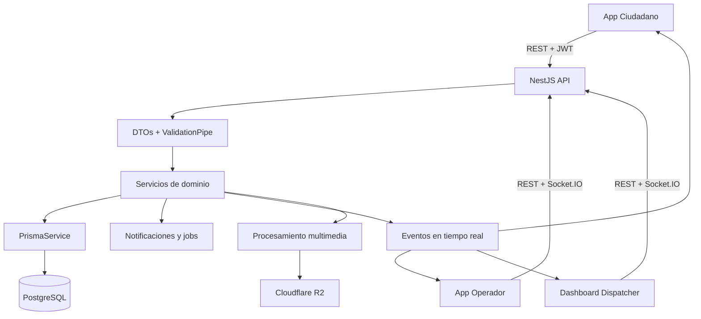

# Ojo Ciudadano

> Plataforma municipal para registrar, despachar y monitorear emergencias en tiempo real. Centraliza información geolocalizada, asignaciones operativas, notificaciones y métricas de atención.

| Ficha Técnica | Detalle |
| :--- | :--- |
| **Stack de Persistencia** | PostgreSQL, Prisma 6, migraciones versionadas y Cloudflare R2 para multimedia |
| **Stack de Backend** | TypeScript, NestJS 11, REST, Socket.IO, `class-validator`, JWT, bcrypt y Jest |
| **Stack de Consumo (Front)** | React, Axios, Leaflet, Expo/React Native, TanStack Query y Socket.IO |
| **Despliegue** | Backend containerizado con Docker sobre un servidor Ubuntu; app mobile distribuida mediante EAS Build de Expo; dashboard web desplegado en Cloudflare Pages |
| **Repositorio / Código** | [tomasabrate/OjoCuidadano_Tancacha_CBA](https://github.com/tomasabrate/OjoCuidadano_Tancacha_CBA) |

---

## Funcionalidades

- Registro de emergencias con ubicación, servicio, subtipo, cuestionario de riesgos y archivos multimedia.
- Cálculo automático de urgencia y aplicación de límites y ventanas de cancelación o edición.
- Despacho y autoasignación de unidades, con seguimiento de inicio, llegada y cierre.
- Actualizaciones en tiempo real mediante Socket.IO para ciudadanos, operadores y dashboard.
- Historial filtrado y paginado, métricas operativas y reportes de incidentes.
- Notificaciones con control de destinatarios, entregas, aperturas y reintentos.

## Arquitectura y Flujo

El sistema coordina emergencias de Policía, Bomberos, Salud y Guardia Urbana. El backend recibe un reporte ciudadano, valida su información, calcula la urgencia, persiste el incidente, notifica a los responsables y registra su evolución hasta el cierre.

La información procesada incluye ubicación, servicio, subtipo, cuestionario de riesgos, unidades asignadas, tiempos de atención, archivos multimedia y eventos de auditoría.



## Persistencia y Datos

#### Paradigma y motor

PostgreSQL se utiliza como base transaccional para un dominio con relaciones fuertes, estados controlados, consultas por fecha/servicio y operaciones concurrentes. Prisma proporciona tipado, migraciones reproducibles y acceso relacional desde TypeScript.

El sistema también genera métricas derivadas mediante `count`, `groupBy` y cálculo de tiempos promedio. No se persiste un historial de cada posición GPS: `EmergencyUnit` mantiene la última ubicación conocida para el mapa operativo.

#### Esquema central

- **`User`:** identidad, rol, servicio, aprobación, credenciales y relación con emergencias, eventos y dispositivos.
- **`Emergency`:** incidente principal. Contiene `status`, `type`, `subType`, `urgencyLevel`, coordenadas, datos del cuestionario, fechas y motivos de cancelación/cierre. Un usuario puede registrar muchas emergencias.
- **`EmergencyUnit`:** unidad operativa asociada a un usuario mediante una relación 1:1. Mantiene tipo, identificador, turno, disponibilidad y última posición.
- **`EmergencyAssignment`:** relación entre emergencias y unidades. Es 1:N en ambos sentidos y registra `assignedAt`, `startedAt`, `arrivedAt`, `closedAt` y el operador que aceptó.
- **`EmergencyEvent`:** historial de hechos del incidente (`CREATED`, `DISPATCHED`, `ARRIVED`, `CLOSED`, `CANCELLED`, entre otros), con actor, notas y timestamp.

El modelo utiliza enums para estados, roles, tipos y niveles de urgencia. Las foreign keys preservan la integridad referencial. Las restricciones principales son:

- `User.email`, `User.firebaseUid` y `EmergencyUnit.unitIdentifier` únicos.
- `User(dni, role)` único.
- `EmergencyAssignment(emergencyId, unitId)` único.
- `Feedback.emergencyId` único.
- `Notification.dedupeKey` único para evitar notificaciones duplicadas.

#### Acceso e integridad

- Las migraciones Prisma versionan la evolución del esquema, incluyendo eventos, asignaciones múltiples, multimedia, Firebase, notificaciones, índices y roles.
- La creación de una emergencia, su evento inicial y su notificación se realiza dentro de una transacción.
- La asignación de unidades utiliza aislamiento `Serializable` y captura errores Prisma `P2002`/`P2034` para responder conflictos de concurrencia con HTTP `409`.
- La cancelación usa una actualización condicional sobre estado y ventana temporal, evitando sobrescribir una asignación concurrente.
- Índices como `[status, type]`, `[urgencyLevel, createdAt]`, `[type, status, createdAt]`, `[status, runAt]` y `[status, nextAttemptAt]` optimizan listados, historial y procesamiento de jobs.
- Las notificaciones se normalizan en `Notification`, `NotificationRecipient`, `NotificationDelivery` y `NotificationOpen`, separando intención, destinatario, entrega y apertura.

## Backend y Lógica

#### Estructura del servidor

El backend está organizado por módulos NestJS:

- **Controladores:** exponen rutas REST y aplican roles.
- **Servicios:** contienen reglas de negocio y orquestan persistencia, eventos y notificaciones.
- **Acceso a datos:** `PrismaService` administra el cliente Prisma y la conexión a PostgreSQL.
- **Infraestructura:** gateway Socket.IO, almacenamiento multimedia, Firebase, correo y procesamiento de notificaciones.
- **Transversal:** guards JWT/roles, filtro global de excepciones e interceptor de tiempos de respuesta.

#### Validación y procesamiento

El `ValidationPipe` global utiliza `whitelist`, `forbidNonWhitelisted` y `transform`. Los DTOs validan:

- enums de servicio y subtipo;
- rangos de latitud/longitud;
- tipos booleanos y enteros;
- longitudes máximas de texto;
- tipo MIME permitido para archivos.

Antes de persistir, `EmergenciesService` calcula automáticamente la urgencia a partir del cuestionario, aplica un límite de cinco alertas por ciudadano cada treinta minutos y establece ventanas de cancelación y edición.

#### Rendimiento y estados

La emergencia mantiene estados globales (`PENDING`, `ASSIGNED`, `IN_PROGRESS`, `ARRIVED`, `CLOSED`, `CANCELLED`) y cada asignación conserva sus propios tiempos. Esto permite atender un incidente con varias unidades sin perder trazabilidad.

El historial admite filtros por fecha, estado, urgencia y servicio. Los reportes limitan la extracción a 2.000 registros. Las lecturas independientes se ejecutan en paralelo y las consultas utilizan `select`, índices y relaciones específicas.

El procesador de notificaciones reclama jobs mediante actualizaciones condicionales, procesa lotes de hasta 20 registros, incrementa intentos y reprograma fallos. Los errores de dominio se traducen a `401`, `403`, `404`, `400` o `409` según corresponda.

## Integración y API

#### Contrato de intercambio

La API se publica bajo `/api/v1`, utiliza JWT Bearer y expone documentación Swagger.

| Endpoint | Uso |
| :--- | :--- |
| `POST /emergencies` | Crear una emergencia validada |
| `GET /emergencies/active` | Consultar emergencias activas según rol y servicio |
| `GET /emergencies/history` | Consultar historial filtrado y paginado |
| `PATCH /emergencies/:id/cancel` | Cancelar una emergencia dentro de la ventana permitida |
| `PATCH /emergencies/:id/status` | Actualizar/cerrar el estado global |
| `POST /dispatch/emergencies/:id/assign` | Asignar una unidad desde el dashboard |
| `POST /dispatch/emergencies/:id/self-assign` | Autoasignación del operador |
| `PATCH /dispatch/emergencies/:id/start` | Registrar inicio del recorrido |
| `PATCH /dispatch/emergencies/:id/arrive` | Registrar llegada |
| `PATCH /dispatch/units/my-location` | Actualizar ubicación de la unidad |
| `GET /metrics/summary` | Obtener totales, promedios y datos geográficos |
| `GET /metrics/incidents-report` | Generar reporte filtrado de incidentes |

Los DTOs definen las cargas de entrada y los servicios devuelven objetos serializables con enums, timestamps, estados y relaciones seleccionadas. Socket.IO publica cambios de estado, asignaciones, ETA, ubicación y recordatorios a rooms controladas por rol y servicio.

#### Consumo funcional en cliente

El dashboard consume los endpoints mediante Axios, representa estados, mapas, historial y métricas, y recibe actualizaciones por Socket.IO. La aplicación mobile utiliza Axios, TanStack Query y Socket.IO para crear alertas, consultar historial, actualizar estados y recibir asignaciones.

#### Despliegue

- **Backend:** ejecutado en contenedores Docker sobre un servidor Ubuntu, aislando la API y sus dependencias de infraestructura.
- **Aplicación mobile:** compilada y distribuida mediante **EAS Build** de Expo para generar los artefactos de Android/iOS.
- **Dashboard web:** construido como aplicación React y publicado mediante **Cloudflare Pages**.

## Alcance y Decisiones

#### Módulos y áreas de trabajo

La participación técnica se concentró en commits propios, pair-programming, diseño y refactorización colaborativa de:

- modelos Prisma, relaciones, enums, constraints, índices y migraciones;
- `EmergenciesService` y `DispatchService`;
- flujo de creación, cancelación, asignación, llegada y cierre;
- auditoría mediante `EmergencyEvent`;
- persistencia y procesamiento de notificaciones;
- consultas de historial, métricas y reportes;
- contratos DTO, autorización por roles y eventos Socket.IO;
- pruebas unitarias de servicios críticos y manejo de concurrencia.

#### Decisiones técnicas y trade-offs

1. **Estado actual más historial:** `Emergency.status` permite lecturas rápidas y `EmergencyEvent` conserva trazabilidad sin reconstruir cada consulta desde eventos.
2. **Asignaciones 1:N:** permite múltiples unidades por incidente y mantiene tiempos independientes por operador.
3. **Transacciones serializables:** priorizan consistencia ante asignaciones simultáneas, devolviendo conflictos recuperables al cliente.
4. **Multimedia fuera de PostgreSQL:** la base conserva metadata y URL, mientras R2 almacena los archivos, reduciendo el impacto sobre el almacenamiento transaccional.

#### Limitaciones y evolución prevista

1. **Última posición en lugar de histórico GPS:** simplifica el mapa en vivo y reduce escrituras, aunque no permite reconstruir recorridos.
2. **Métricas sobre la base operacional:** resulta adecuado para el volumen actual y mantiene una arquitectura simple; reportes de mayor escala requerirían agregaciones materializadas o procesamiento por lotes.

## Ejecución Local

Instalar las dependencias de cada aplicación y configurar las variables de entorno a partir de los archivos `.env.example` correspondientes. Para iniciar los tres servicios en Windows PowerShell:

```powershell
.\start-all.ps1
```

También pueden iniciarse por separado:

```powershell
cd backend\api
pnpm run start:dev

cd ..\..\dashboard
npm start

cd ..\frontend-mobile
npx expo start --dev-client --clear
```
