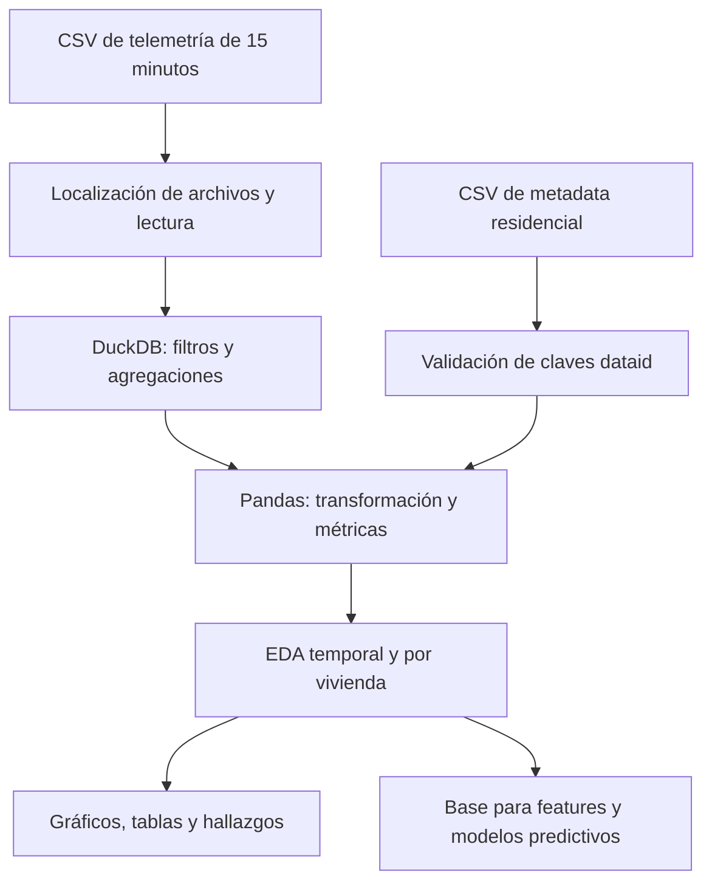

# Smart Grid Data Analytics: Telemetría Residencial de Austin (2018)

[](https://github.com/tomasabrate/Pecan_Street_Austin_Smart_Grid)
[](https://www.kaggle.com/code/tomasabrate/pecan-street-austin-smart-grid?scriptVersionId=355612846)

> Caso de estudio de ingeniería de datos para analizar telemetría eléctrica residencial de 15 minutos, detectar eventos extremos y preparar información para decisiones operativas en redes eléctricas inteligentes.

| Ficha Técnica | Detalle |
| :--- | :--- |
| **Stack de Persistencia** | CSV (`15minute_data_austin.csv` y `metadata.csv`), DuckDB para consultas analíticas, Pandas |
| **Stack de Backend** | Python, notebooks Jupyter, NumPy y funciones auxiliares de ingestión |
| **Stack de Consumo** | Notebook Jupyter, Pandas y Matplotlib para tablas, gráficos e interpretación |
| **Repositorio / Código** | [tomasabrate/Pecan_Street_Austin_Smart_Grid](https://github.com/tomasabrate/Pecan_Street_Austin_Smart_Grid) |

---

## Funcionalidades

- Ingesta y localización de archivos de telemetría y metadata en rutas estándar.
- Validación de columnas, tipos, cobertura temporal, identificadores y valores disponibles de `grid`.
- Consultas y agregaciones con DuckDB antes de cargar resultados en Pandas.
- Enriquecimiento de mediciones temporales con atributos de cada vivienda mediante `dataid`.
- Análisis de estacionalidad, hábitos horarios, voltaje y eventos extremos mediante métricas P95/P99 y visualizaciones.

## Arquitectura y Flujo

El sistema procesa mediciones residenciales de Austin correspondientes a 2018. Su objetivo es caracterizar la demanda por vivienda y distinguir consumo de inyección fotovoltaica: `grid` representa el intercambio neto con la red, por lo que los valores negativos no son nulos ni errores, sino energía exportada.

El flujo combina controles de calidad, consultas sobre datos tabulares, enriquecimiento con metadata de las viviendas y análisis temporal:



El análisis está documentado y pre-ejecutado en el [notebook principal](https://github.com/TomasAbrate/pecan-street-austin-smart-grid/blob/main/notebooks/Pecan_Street_Austin_Smart_Grid.ipynb). También puede consultarse desde [Google Colab](https://colab.research.google.com/github/TomasAbrate/pecan-street-austin-smart-grid/blob/main/notebooks/Pecan_Street_Austin_Smart_Grid.ipynb) o [Kaggle](https://www.kaggle.com/code/tomasabrate/pecan-street-austin-smart-grid?scriptVersionId=355612846).

## Persistencia y Datos

#### Paradigma y motor

La persistencia de entrada es orientada a archivos: el dataset temporal y la metadata se mantienen separados para evitar duplicar atributos estáticos en cada medición. DuckDB funciona como capa SQL embebida para filtrar y agregar antes de materializar resultados en Pandas, reduciendo cargas innecesarias en memoria. No se implementa un servidor de base de datos, ORM ni migraciones; el alcance es analítico y reproducible, no transaccional.

#### Esquema central

- **Telemetría residencial:** identificada por `dataid` y `localminute`, con variables eléctricas como `grid`, `leg1v` y `leg2v`. La granularidad de 15 minutos permite estudiar estacionalidad, horarios y persistencia de picos.
- **Metadata de vivienda:** relación descriptiva por `dataid`, con atributos estructurales y operativos como tipo de edificio, ciudad/estado, fechas de disponibilidad y equipamiento.
- **Observaciones derivadas:** agregaciones por vivienda y período, incluidos conteos válidos, cobertura, medias, cuantiles P95/P99 y eventos extremos.

La clave `dataid` permite enriquecer la serie temporal con atributos de la vivienda. La integridad se controla mediante conteos de registros válidos, cobertura esperada y tratamiento explícito de `NULL`; una ausencia de transmisión no se convierte automáticamente en consumo cero.

#### Acceso, consistencia y rendimiento

- Se usan consultas SQL de DuckDB para filtrar/agrupar datos masivos antes de pasarlos a Pandas.
- Las transformaciones conservan la semántica de los valores negativos de `grid` y separan valores faltantes de ceros reales.
- El análisis compara umbrales globales con percentiles propios por vivienda. El P95 de `grid` varía aproximadamente entre 1.686 y 5.264, evidencia de que un umbral global no representa a todos los hogares.
- La normalización temporal y el uso de timestamps permiten estudiar continuidad, estacionalidad y hábitos horarios. No hay transacciones ACID ni índices persistentes porque no existe un motor relacional operativo en este repositorio.

## Backend y Lógica

#### Estructura del servidor

No hay un backend HTTP ni una capa de controladores/servicios/repositorios tradicional. La arquitectura efectiva es:

1. `src/utils.py`: localiza archivos en rutas estándar (`data/raw`, Kaggle, `/mnt/data` o el directorio actual) y falla explícitamente si el archivo no existe.
2. Notebook: ejecuta la ingesta, validaciones, consultas DuckDB, transformaciones, agregaciones y visualizaciones.
3. `src/download_data.py`: automatiza la descarga mediante Kaggle CLI; requiere credenciales locales y debe configurarse con el identificador real del dataset antes de usarlo.

#### Procesamiento y validación

La carga se audita antes del análisis: se revisan columnas, tipos, cobertura temporal, identificadores de vivienda y disponibilidad de `grid`. Luego se calculan métricas por hogar, se incorporan atributos de `metadata.csv` y se generan visualizaciones para consumo, tensión y eventos extremos.

#### Rendimiento y estados

El diseño evita leer toda la tabla en Pandas cuando una consulta SQL puede reducir primero el volumen. También usa agregaciones por vivienda, filtros temporales y cuantiles P95/P99 para mitigar análisis costosos. El principal estado persistente son los CSV originales y los resultados renderizados del notebook; no hay colas, sesiones de usuario ni concurrencia de escritura.

## Integración y API

Este repositorio no expone endpoints REST/GraphQL ni DTOs serializados. El contrato de intercambio es el esquema de los archivos:

- `15minute_data_austin.csv`: hechos temporales por `dataid` y `localminute`, incluyendo `grid` y variables eléctricas.
- `metadata.csv`: atributos estáticos relacionados mediante `dataid`.
- `requirements.txt`: dependencias necesarias para reproducir el pipeline.

El consumo funcional ocurre en el notebook: DuckDB y Pandas producen tablas agregadas, y Matplotlib las convierte en gráficos de demanda, estacionalidad, voltaje y eventos extremos. El “frontend” se limita a presentar resultados analíticos; no existe una aplicación web independiente.

## Alcance y Decisiones

La participación en el desarrollo principal abarcó el diseño y la evolución colaborativa del pipeline, incluidos cambios realizados mediante pair programming:

- Diseño del flujo de ingestión, auditoría y transformación de telemetría residencial.
- Modelado lógico de la relación entre mediciones temporales y metadata mediante `dataid`.
- Implementación de consultas DuckDB y agregaciones por hogar para evitar cargas masivas innecesarias.
- Definición de reglas semánticas para nulos, valores negativos de `grid`, cobertura y umbrales P95/P99.
- Estructuración del notebook reproducible y de las utilidades Python para localizar y descargar datos.

#### Decisiones técnicas y trade-offs

- **CSV + DuckDB frente a una base transaccional:** menor complejidad operativa y buena capacidad analítica local, a cambio de no ofrecer escrituras concurrentes, índices administrados ni garantías ACID.
- **Pandas después de filtrar:** conserva la productividad del análisis exploratorio sin pagar el coste de materializar todo el dataset desde el inicio.
- **Percentiles por vivienda frente a un umbral global:** representa la heterogeneidad real de los hogares y reduce falsos positivos al detectar eventos de alto consumo.
- **Nulos semánticos frente a imputación automática:** evita transformar fallas de transmisión en señales eléctricas artificiales.

#### Limitaciones y evolución prevista

- El repositorio no incluye un backend HTTP, una base de datos transaccional ni una aplicación web; el consumo se realiza desde el notebook.
- La persistencia se basa en archivos CSV, por lo que no ofrece índices administrados, escrituras concurrentes ni garantías ACID.
- `src/download_data.py` requiere credenciales locales de Kaggle y configuración del identificador real del dataset antes de ejecutarse.
- La siguiente evolución puede incorporar feature engineering, validación temporal sin *data leakage* y una etapa de despliegue MLOps, tal como se documenta en el notebook.

## Ejecución Local

```text
.
├── README.md
├── requirements.txt
├── metadata.csv
├── 15minute_data_austin.csv
├── src/
│   ├── utils.py
│   └── download_data.py
└── notebooks/
    └── Pecan_Street_Austin_Smart_Grid.ipynb
```

1. Clona el repositorio.
2. Instala las dependencias con `pip install -r requirements.txt`.
3. Ejecuta el notebook o ábrelo mediante los enlaces de Colab/Kaggle.
4. Para descargar datos nuevos, configura `kaggle.json`, revisa el identificador en `src/download_data.py` y coloca los archivos en la ruta esperada.

Los datasets son pesados y deben mantenerse fuera de Git en un flujo de producción. El notebook contiene las tablas y conclusiones renderizadas para consultar los resultados sin ejecutar todo el pipeline.
