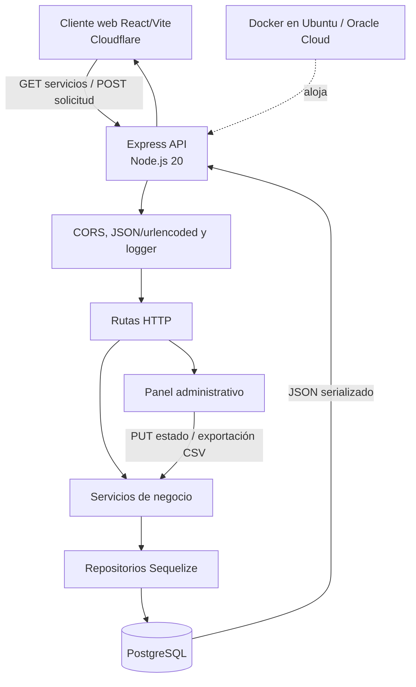

# TS Desarrollos — Caso de Estudio de Ingeniería

> Plataforma web para publicar servicios y convertir consultas comerciales en solicitudes persistentes y gestionables. El backend centraliza validación, estados y exportación operativa, reduciendo el acoplamiento entre el sitio público y la gestión interna.

| Ficha Técnica | Detalle |
| :--- | :--- |
| **Stack de Persistencia** | PostgreSQL, Sequelize ORM, `sequelize.sync()` para materialización del esquema, SQL generado y registrado |
| **Stack de Backend** | JavaScript ES Modules, Node.js 20 Alpine, Express, CORS, `dotenv`, middleware de logging |
| **Stack de Consumo (Front)** | React 19, Vite, Axios y Fetch API, React Router |
| **Repositorio / Código** | [ts-desarrollos/ts-web](https://github.com/ts-desarrollos/ts-web) |

## Funcionalidades

- **Catálogo de servicios:** publicación dinámica de servicios técnicos organizados por categorías, descripción técnica y precios base con soporte para valores a cotizar.
- **Captura y trazabilidad de solicitudes:** formulario de contacto que convierte consultas web en registros persistentes en base de datos relacional con trazabilidad temporal.
- **Gestión operativa y estados:** panel administrativo para revisar requerimientos, contabilizar consultas pendientes (`Pendiente`) y actualizar ciclo de atención (`Resuelto`).
- **Exportación de datos:** generación y descarga en caliente de reportes tabulares en formato CSV normalizado para análisis y seguimiento operativo.

## Arquitectura y Flujo

TS Desarrollos necesitaba una presencia web que no solo mostrara su catálogo, sino que capturara consultas de clientes, conservara su trazabilidad y permitiera resolverlas desde un panel administrativo. La solución separa el catálogo (`servicios`) del flujo de atención (`solicitudes`), con persistencia relacional y estados de negocio.

El backend se desplegó en un servidor Ubuntu de Oracle Cloud dentro de Docker. El sitio cliente se publicó mediante Cloudflare y se configura para consumir la URL de la API con `VITE_API_URL`; el backend restringe CORS mediante `FRONTEND_URL` y permite el origen local de desarrollo.



## Persistencia y Datos

- **Paradigma y motor:** PostgreSQL se utiliza como motor relacional transaccional y Sequelize como ORM. Es adecuado para el volumen y la naturaleza del sistema: altas de solicitudes, actualización de estados, consulta ordenada por fecha y lectura del catálogo. La conexión usa `DATABASE_URL` y SSL (`rejectUnauthorized: false`) para el entorno gestionado.

- **Esquema central:**

  | Tabla | Atributos relevantes | Integridad y uso |
  | :--- | :--- | :--- |
  | `servicios` | `id` autoincremental, `nombre`, `categoria`, `descripcion`, `precio_base`, `tips`, `orden`, `createdAt`, `updatedAt` | `id` es PK; `nombre` y `categoria` son obligatorios. `precio_base` es entero y nullable para representar “A consultar”. |
  | `solicitudes` | `id` autoincremental, `cliente_nombre`, `cliente_email`, `cliente_telefono`, `mensaje`, `estado`, `createdAt`, `updatedAt` | `id` es PK; nombre, correo y mensaje son obligatorios; teléfono es opcional; `estado` inicia en `Pendiente`. |

  La cardinalidad actual es independiente: una solicitud no guarda una FK a `servicios`, porque el mensaje conserva el detalle enviado por el cliente y puede referir una consulta general. Los timestamps automáticos permiten ordenar y auditar el ciclo de atención, aunque no constituyen una serie temporal de sensores ni métricas acumuladas.

- **Acceso e integridad:** los modelos se registran al iniciar la aplicación y `authenticate()` verifica la conectividad antes de `sequelize.sync()`. El repositorio de solicitudes ordena por `createdAt DESC`, y las operaciones de actualización usan `findByPk` seguido de `save()`. El repositorio de servicios encapsula listado, búsqueda por ID y creación.

  El código no contiene una carpeta de migraciones, índices secundarios, constraints únicos, FKs ni transacciones explícitas. En consecuencia, `sync()` simplifica el despliegue inicial, pero para evolución controlada del esquema convendría migrar a Sequelize CLI/migrations y agregar índices sobre `solicitudes.estado` y `createdAt` si crece la carga administrativa. La base mantiene consistencia por registro mediante PK, `allowNull` y timestamps; la consistencia de cambios multioperación no está modelada porque cada caso de uso actual ejecuta una única operación de escritura.

## Backend y Lógica

- **Estructura del servidor:** `app.js` compone configuración, CORS, parseo de payloads, logging, routers y arranque de base de datos. Las rutas HTTP delegan en servicios; los servicios aplican reglas mínimas de negocio; los repositorios concentran el acceso Sequelize; y los modelos describen el esquema. Esta separación permite cambiar la persistencia sin trasladar consultas a los controladores.

- **Procesamiento y validación:** `POST /api/servicios` exige `nombre` y `categoria`. `POST /api/solicitudes` exige `cliente_nombre`, `cliente_email` y `mensaje`; el teléfono es opcional. `PUT /api/solicitudes/:id` exige un estado y verifica que exista la solicitud antes de guardarla. Express transforma JSON y formularios URL-encoded; Sequelize serializa los atributos a SQL parametrizado.

  La validación es de presencia, no existe un DTO/schema formal ni validación de formato de correo, longitud, catálogo cerrado de estados o sanitización específica de CSV. Las rutas convierten errores de validación en `400`, errores de consulta en `500`, creaciones en `201` y respuestas exitosas en `200`. El middleware registra fecha, método y URL; Sequelize dispone además de un logger SQL formateado configurable.

- **Rendimiento y estados:** el catálogo se consulta completo y las solicitudes se consultan completas, ordenadas por fecha. El endpoint de notificaciones ejecuta un `COUNT` de solicitudes pendientes y el panel permite pasar una solicitud de `Pendiente` a `Resuelto`. No hay paginación, filtros avanzados, caché ni control optimista de concurrencia; por el tamaño operativo esperado, la solución prioriza simplicidad y trazabilidad. La exportación genera CSV en memoria y normaliza saltos de línea del mensaje para no romper filas.

## Integración y API

| Endpoint | Contrato funcional | Respuestas observables |
| :--- | :--- | :--- |
| `GET /api/servicios` | Lista JSON de servicios; devuelve `{ mensaje }` si está vacío | `200`, `500` |
| `POST /api/servicios` | Recibe JSON con `nombre`, `categoria` y campos opcionales | `201` con entidad, `400` por validación |
| `GET /api/solicitudes` | Lista JSON ordenada por `createdAt` descendente | `200`, `500` |
| `POST /api/solicitudes` | Recibe nombre, email, teléfono opcional y mensaje | `201` con `{ mensaje, data }`, `400` |
| `PUT /api/solicitudes/:id` | Recibe `{ "estado": "Resuelto" }` | `200` con entidad, `400` si falta estado o no existe |
| `GET /api/solicitudes/admin/notificaciones` | Devuelve `{ "nuevas": number }` para pendientes | `200`, `500` |
| `GET /api/solicitudes/admin/exportar` | Descarga `Solicitudes_TSDesarrollos.csv` | `text/csv`, `500` |

El cliente encapsula el catálogo y el envío mediante Axios, y utiliza `fetch` para el formulario y el panel administrativo. Las respuestas JSON se convierten directamente en estado React para mostrar servicios, confirmaciones y la tabla de solicitudes; el CSV se abre como descarga del navegador. La URL base se parametriza por entorno, manteniendo el mismo contrato entre desarrollo local y despliegue.

## Alcance y Decisiones

- **Módulos bajo mi autoría:** participé en el diseño y refactorización del modelo relacional de `servicios` y `solicitudes`, incluyendo campos de negocio, timestamps y transición de estados. Implementé colaborativamente la capa de modelos Sequelize, repositorios de acceso, servicios de validación y rutas REST para altas, consultas, actualización de estados, contador de pendientes y exportación operativa.

- **Diseño de flujo de datos:** contribuí a mover el catálogo desde datos embebidos en el frontend hacia persistencia en base de datos, dejando al cliente como consumidor del API. También participé en el contrato de configuración por entorno (`DATABASE_URL`, `FRONTEND_URL`, `VITE_API_URL`) y en la integración CORS.

- **Despliegue y operación:** colaboré en la contenerización del backend con Node 20 Alpine, `npm ci --omit=dev` y arranque reproducible mediante Docker. El proceso operativo documentado actualiza el código en Ubuntu/Oracle Cloud y reconstruye el servicio con `docker compose up -d --build`; el frontend se entrega a través de Cloudflare.

- **Decisiones técnicas y trade-offs:** se eligió Sequelize para mantener modelos y consultas expresivos sin acoplar las rutas a SQL manual. La separación servicio/repositorio facilita pruebas y evolución, mientras que `sync()` reduce fricción en una primera puesta en producción, a costa de no ofrecer versionado formal del esquema. Se mantuvo `precio_base` nullable para representar servicios cotizados caso a caso y se conservaron timestamps para ordenar y operar solicitudes sin introducir una tabla de historial adicional. Para una siguiente etapa, priorizaría migraciones, DTOs con validación estructural, estados restringidos, autenticación real del panel, paginación e índices selectivos.

## Ejecución Local

1. **Clonar repositorio:**
   ```bash
   git clone https://github.com/ts-desarrollos/ts-web.git
   cd ts-web
   ```

2. **Levantar backend (Node.js & Express):**
   ```bash
   cd backend
   npm install
   # Configurar variables en .env (DATABASE_URL, PORT=3000, FRONTEND_URL=http://localhost:5173)
   npm run dev
   ```

3. **Levantar frontend (React & Vite):**
   ```bash
   cd ../frontend
   npm install
   # Configurar .env con VITE_API_URL=http://localhost:3000
   npm run dev
   ```

4. **Despliegue con Docker Compose (Alternativa):**
   ```bash
   docker compose up -d --build
   ```
